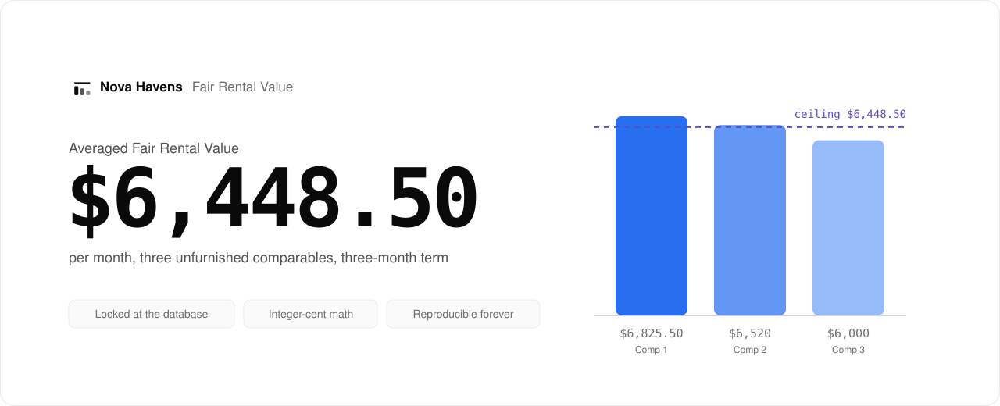
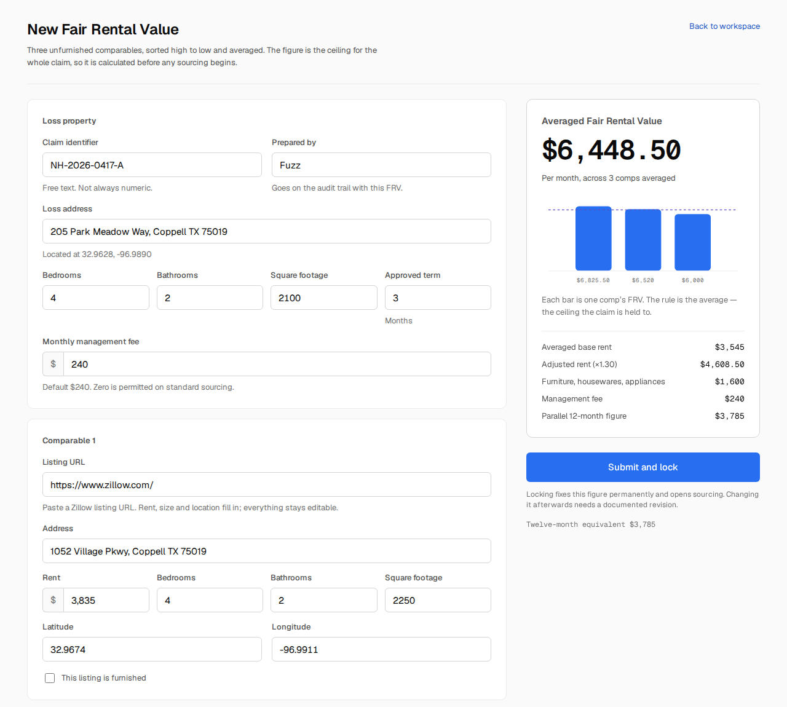
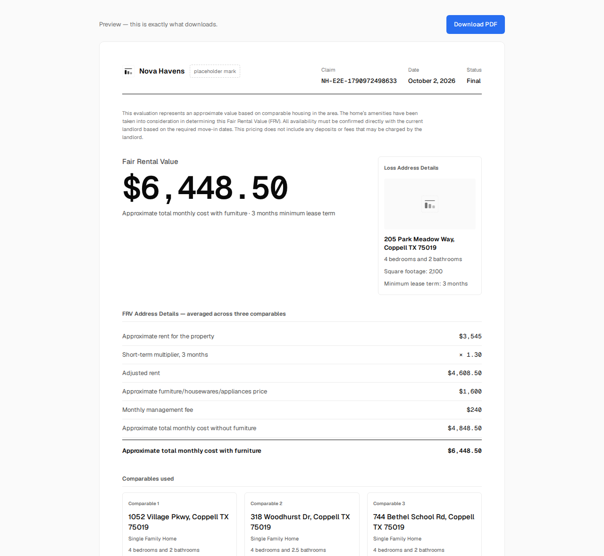
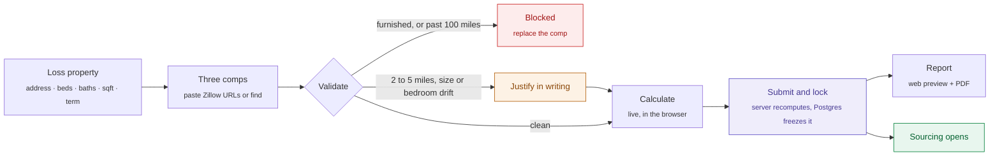
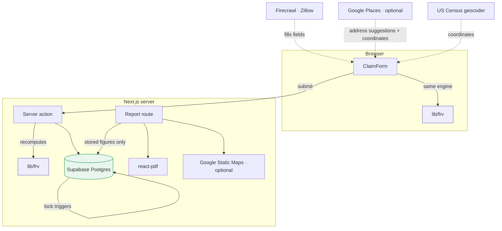

<div align="center">

<picture>
  <source media="(prefers-color-scheme: dark)" srcset="docs/assets/hero-dark.svg">
  
</picture>

<br>

# FRV

**The monthly housing ceiling on an insurance claim — calculated once, defended forever.**

<p>
  <a href="https://github.com/Novahavens/FRV/actions/workflows/ci.yml"></a>
  <a href="https://frvasap.com"></a>
  
  
  
  
  
</p>

<p>
  <a href="#the-number">The number</a> ·
  <a href="#intake">Intake</a> ·
  <a href="#how-a-claim-moves">How a claim moves</a> ·
  <a href="#the-five-rules">The five rules</a> ·
  <a href="#finding-comparables">Finding comparables</a> ·
  <a href="#the-report">The report</a> ·
  <a href="#architecture">Architecture</a> ·
  <a href="#quick-start">Quick start</a> ·
  <a href="#deploying">Deploying</a>
</p>

</div>

---

When a home becomes uninhabitable, a policy's Additional Living Expenses coverage pays for somewhere else to live. The **Fair Rental Value** is the monthly ceiling on that spend. Carriers don't calculate it themselves — setting a number you have a financial interest in keeping low is a lawsuit — so they hand it to a neutral third party.

That third party is Nova Havens. **This is the tool that produces the number.** It runs at **[frvasap.com](https://frvasap.com)**.

An account manager enters the loss property, chooses three unfurnished Zillow comparables, and receives a single-page report an adjuster can approve without picking up the phone. Every rule in the methodology is enforced by the software, the arithmetic is reproducible to the cent from stored data alone, and once the figure locks, **the database itself refuses to let it move.**

<br>

## The number

```
per comp  =  (base comp rent × short-term multiplier)  +  furniture
FRV       =  the average of the three comps, sorted high to low
```

There is **no management fee**. It was retired in October 2026 with Lou's sign-off. Reports locked before then keep the fee they were calculated with and still print it.

<table>
<tr><td valign="top">

| Approved term | Markup | Multiplier |
|:--|--:|--:|
| 1 – 2 months | 40% | × 1.40 |
| 3 – 5 months | 30% | × 1.30 |
| 6 – 9 months | 25% | × 1.25 |
| 10 – 11 months | 10% | × 1.10 |
| 12+ months | 10% | × 1.10 |

<sub>Locked, as Lou set them on 12 October 2026. The schedule is fixed on every claim, stored with it and printed on the report.</sub>

</td><td valign="top">

| Loss bedrooms | Furniture / month |
|:--|--:|
| 1 | $1,059 |
| 2 | $1,267 |
| 3 | $1,456 |
| 4 | $1,600 |
| 5 | $1,746 |
| 6 | $1,978 |
| 7 | $2,242 |
| 8 | $2,540 |
| 9 | $2,879 |
| 10 | $3,262 |

<sub>1–5 are the original rates. 6–10 (October 2026) continue from 5 at the average 1→5 step ratio, ≈ ×1.133, rounded to the dollar.</sub>

</td><td valign="top">

| Reference claim | FRV |
|:--|--:|
| Coppell, TX · 3 comps · 3 mo | **$6,448.50** |
| Camarillo, CA · 2 mo | **$10,145** |

<sub>Computed under the original multiplier schedule and with the management fee the PRD reports carried. Kept as arithmetic regressions: if they move, the engine changed.</sub>

</td></tr>
</table>

Furniture follows the **loss** property's bedroom count, never the comp's, and does not scale with term. The figure is recomputed on the server at submit, stored with the calculation, and printed on the report, so the workings an adjuster checks always match it.

<br>

## Intake

<table>
<tr>
<th align="center">Intake — one page, live figure</th>
<th align="center">Report — web preview and PDF from one model</th>
</tr>
<tr>
<td width="50%" valign="top"></td>
<td width="50%" valign="top"></td>
</tr>
<tr>
<td><sub>The figure updates as you type. Submit is the only state change.</sub></td>
<td><sub>Section order follows the Alacrity format adjusters already read. The PDF is the same model, rendered server-side.</sub></td>
</tr>
</table>

One page, top to bottom:

- **Prepared by** is a dropdown of account managers, read from the `account_managers` table. The server rejects a name not on the list, so the audit trail carries one spelling per person.
- **Loss address** offers Google Places suggestions when `NEXT_PUBLIC_GOOGLE_MAPS_API_KEY` is set; picking one fills the address and coordinates together. Without the key it is a plain field, and the US Census geocoder looks the coordinates up when the field loses focus. Coordinates are captured once and stored, because Rule 4 depends on them. The Maps script is loaded once per page by `places-loader.ts`, which waits for Google's own ready callback before asking for the Places library.
- **Bedrooms and bathrooms** are steppers with up and down arrows, not typed. Loss bedrooms run 1–10, one per furniture rate; comp bedrooms 1–10; bathrooms 0.5–10 in half steps. A listing value between steps, such as 1.75 baths, snaps to the next step in the direction pressed.
- **Approved term** is a dropdown of 1 to 12 months, defaulting to 3. The engine accepts longer terms; the form offers the first year.
- **Short-term multipliers** are locked: the form shows the schedule read-only, and the server ignores any other.
- **Three comparables**, filled by pasting a Zillow URL or picked from *Find comparables*. Every field stays editable, and the audit trail records what a person changed.

<br>

## How a claim moves



<br>

## The five rules

These lived in a reference guide as advice for people. Here they are system behaviour, because a rule that is only documented is a rule that gets skipped at 4pm on a Friday.

| | Rule | Enforced by | When it fails |
|:-:|:--|:--|:--|
| **1** | Unfurnished comps only | Furnished flag and listing-text keyword scan in the engine, plus a `check` constraint so a furnished comp cannot even be stored | Rejected. No override exists, at any permission level. |
| **2** | FRV before sourcing | `sourcing_unlocked` is set only by the lock transition | Sourcing stays closed |
| **3** | Sort high to low | `sort_position` persisted with the record, never recomputed at render | Re-sorted; entry order kept in the audit trail |
| **4** | Geography over everything | Haversine bands from coordinates captured at intake: under 1 mi and 1–2 mi pass, 2–5 mi needs a written justification, 5–100 mi is permitted and noted, past 100 mi halts | Past one hundred miles the calculation stops rather than widening |
| **5** | Locked once set | Postgres triggers on `claims`, `comps` and `calculations`; `open_revision()` is the only way through | A new immutable version plus a reason-coded revision record |

Bedroom count is checked: a comp with a different count is flagged for acknowledgement. **Bathroom count deliberately is not** — a 4-bed/2.5-bath comp was correctly used for a 3-bed/3-bath loss because square footage and location mattered more. See [the decision log](docs/DECISIONS.md#bathrooms-are-not-matched).

<br>

## Finding comparables

Listing data comes through **Firecrawl's catalogued Zillow capabilities**, approved by Will and Lou in October 2026. Zillow has offered no public API since September 2021, and its partner programme requires MLS membership.

**Paste a URL** (`properties/rental`) and the comp fills itself: rent, bedrooms, bathrooms, square footage, coordinates. Expired listings are refused, because a comp no longer for rent is not evidence.

**Find comparables** (`properties/rental_search`) returns a shortlist the account manager picks from. It never picks for them, and it never writes to a claim.

- **Eligible:** active rentals within ±1 bedroom, ±1 bathroom and ±15% square footage of the loss. Apartment communities are excluded.
- **Unfurnished only.** Zillow's search can restrict *to* furnished but not away from it, so each search also pulls the furnished listings and subtracts them, at one extra Firecrawl call per region. Rule 1's full-text check on pick is still the final gate.
- **Radius is the operator's choice:** 5 miles by default, with a picker for 5 / 10 / 25 / 50 miles. Nothing widens automatically; thin results suggest the next step.
- **The Find comps button shows when it can be clicked.** While the loss address and square footage are missing it is the plain grey button. Once both are set it lights up as a neon glass button, so the operator can see the search is ready. The styles live in `ClaimForm.module.css`, with reduced-motion respected.
- **Coverage thins as the radius grows.** Zillow searches by region, not radius: 5 miles searches the ZIP and city, and past 5 miles adds the state. Distance is then filtered by Haversine. A 50-mile search is the widest the picker offers, not an exhaustive one.
- **Order:** most like the loss first (bedrooms, bathrooms, size, single-family), nearest as the tiebreaker, never rent. Cards read "Exact match" or "Close match".
- **Past 5 miles** a card shows a light red hue and a "Past 5 mi" chip as a cue. Rule 4 permits it up to 100 miles, and the distance prints on the report.
- **Filter results** by home type, pets, available-by date, exact beds or exact baths, from facts the search already returns. Amenities such as garage or pool are not in those records and are not fetched.

Picking a candidate runs the same single-listing lookup as a pasted URL, so every rule still applies. Records carry Zillow's attribution, and any report built from them prints it. Without `FIRECRAWL_API_KEY` the form works identically with manual entry, and a licensed provider can replace Firecrawl by implementing `ListingProvider`.

**Zillow is the only source, on purpose.** Furnished Finder was considered and declined: its inventory is furnished by definition, which Rule 1 rejects. See [the decision log](docs/DECISIONS.md#comp-search-stays-zillow-only-furnished-finder-declined-october-2026).

<br>

## The report

Section structure follows the Alacrity format carriers already receive — Loss Address Details, FRV Address Details, comparables, 12-month FRV Details, guideline tables, neutrality declaration — so an adjuster finds every number where they always have. Underneath, it is Nova Havens' methodology: three comps averaged where Alacrity carries one.

- **Reports render from stored figures.** The engine is never consulted at render time, so a methodology change cannot restate a report an adjuster has already accepted. That is why a report locked before October 2026 still shows its management fee row, and a new one has none.
- **Guideline tables are generated from the constants the engine reads**, so the workings can never disagree with the figure. The PDF prints the ten-row furniture table in two halves, 1–5 beside 6–10, to stay on one page.
- **Imagery.** When `GOOGLE_MAPS_SERVER_KEY` is set, the report carries a Street View photo of the loss address and a hybrid aerial map with the loss as a red "L" pin and the comps as pins 1–3. The key stays server-side: the web report loads images through `/api/claims/:id/street-view` and `/api/claims/:id/map`. Without the key the report shows a house placeholder and no map.
- `GET /api/claims/:id/report` returns the PDF. It renders only for locked claims, from stored figures, and is never cached.

<br>

## Architecture



```
src/
├── lib/
│   ├── frv/            Pure calculation core. No I/O, no framework, no network.
│   │   ├── constants.ts    The methodology: multipliers, furniture 1–10, radius bands. Changes need Lou
│   │   ├── money.ts        Integer-cent arithmetic and formatting
│   │   ├── geo.ts          Haversine distance and radius bands
│   │   ├── multiplier.ts   Term tiers and furniture lookup
│   │   ├── validate.ts     The rules as executable checks
│   │   └── calculate.ts    Selection (high-to-low) and output (three-comp average)
│   ├── listings/       Zillow lookup and search behind ListingProvider; pure ranking and filters
│   ├── maps/           Street View and Static Maps URLs and fetches (server-only key)
│   ├── report/         Report view-model and verbatim declarations
│   ├── db/             Supabase access — the only layer that knows about storage
│   └── env.ts          Environment, validated once
├── components/         UI bound to design tokens, including the Stepper control
│   └── forms/          Loss address autocomplete; places-loader.ts loads Google Maps once
└── app/
    ├── claims/new/     Intake: one page, live figure, server actions
    ├── report/         On-screen report
    └── api/            PDF, report imagery, health check

supabase/   Schema, lock triggers, open_revision(), seed
tests/      Reference fixtures and unit tests
docs/       Decision log, assets, planned work (docs/plans/)
```

Four ideas carry the whole design.

> **The core is a pure island.** Nothing from React, Next or Supabase reaches into `lib/frv`. That is what makes the fixtures meaningful, and it is why the browser can run the exact code the server runs — the live preview isn't an approximation of the answer, it *is* the answer. The server recomputes on submit regardless.

> **Money is integer cents.** Dollars exist only at parse and format. A multiply-then-average chain in floating point accumulates error, and this number is the ceiling on someone's housing for months.

> **The lock is a database trigger, not a hidden button.** Hiding a control is a suggestion; a rejected write is a guarantee. It holds against the app, a script, and the Supabase dashboard alike.

> **Reports render from stored figures.** One view-model feeds both the web preview and the PDF; layout may differ between them, content cannot.

<br>

## Quick start

```bash
git clone https://github.com/Novahavens/FRV.git && cd FRV
cp .env.example .env.local
npm ci
npm run dev
```

Without Supabase configured, the app renders the Coppell reference claim and says so on screen. An unlabelled sample that looks real is how someone emails a fake FRV to an adjuster.

| Variable | Purpose |
|:--|:--|
| `NEXT_PUBLIC_SUPABASE_URL` | Project URL |
| `SUPABASE_SERVICE_ROLE_KEY` | Server-only. A new-style `sb_secret_…` key works here |
| `FIRECRAWL_API_KEY` | Optional. Empty means manual comp entry |
| `NEXT_PUBLIC_GOOGLE_MAPS_API_KEY` | Optional. Places API (New) key for the browser. Restrict by HTTP referrer to `frvasap.com`, `*.frvasap.com` and the `vercel.app` hosts. Empty means a plain address field with Census geocoding |
| `GOOGLE_MAPS_SERVER_KEY` | Optional. Server-only key for Maps Static API and Street View Static API. Restrict by API only, not by referrer, because Vercel calls it from the server. Empty means no Street View photo and no aerial map |

To run against a real database:

```bash
for f in supabase/migrations/*.sql; do psql "$DATABASE_URL" -f "$f"; done
psql "$DATABASE_URL" -f supabase/seed.sql      # optional reference claim
```

| Command | Does |
|:--|:--|
| `npm run dev` | Local server at `localhost:3000` |
| `npm test` | Reference fixtures and unit tests |
| `npx vitest run -t "Coppell"` | Just the tests matching a name |
| `npm run typecheck` | Strict TypeScript, `noUncheckedIndexedAccess` on |
| `npm run verify` | Typecheck, test and production build — the pre-push gate. The build must pass with no variables set |

<br>

## Deploying

Vercel, Node runtime, auto-deploys from `main`. Set the two Supabase variables (and the optional keys), then point the deploy gate at **`GET /api/health`** — it checks configuration and database reachability, and returns `503` until both are sound. Environment is validated in `src/lib/env.ts`, so a missing key fails at boot, not when someone hits submit.

Production is **public**: Vercel password protection is off (October 2026), and the app has no login yet, so anyone with the link can create and lock claims. *Prepared by* is a chosen name, not an identity. Application auth is still to come; until then, keep the link inside Nova Havens.

### Production domain

The app is served at **`https://frvasap.com`**. `www.frvasap.com` permanently redirects (308) to it. The Vercel project `frv` (team `nova-havens`) holds the domain entries, and Vercel issues and renews the certificates. The `vercel.app` hosts (`frv-nova-havens.vercel.app`, `frv-lilac.vercel.app`) continue to work.

DNS lives at the registrar (GoDaddy, nameservers `ns33`/`ns34.domaincontrol.com`):

| Type | Name | Value |
|:--|:--|:--|
| A | `@` | `216.150.1.1` |
| CNAME | `www` | `cname.vercel-dns.com` |

If the domain stops resolving or shows a certificate error, check these two records first. A certificate for `www` does not cover the bare domain; each needs its own.

<details>
<summary><strong>Two things that only break on Vercel</strong></summary>
<br>

- **PDF fonts and images.** pdfkit requires its built-in fonts with a dynamic `require` that output tracing cannot see, and the PDF reads its logo and placeholder from `public/images`. `next.config.mjs` ships both via `outputFileTracingIncludes`; without it the PDF route fails on Vercel only.
- **Hydration.** The intake form is server-rendered, then hydrated. Automated tests must wait for hydration before interacting, or React resets the inputs.

</details>

<br>

## Database

| Migration | What it does |
|:--|:--|
| `0001_init.sql` | Schema, `check (furnished = false)`, lock triggers, `open_revision()`, RLS |
| `0002_pin_function_search_path.sql` | Pins `search_path` on every function (Supabase lint 0011) |
| `0003_fix_claims_guard_return_on_delete.sql` | BEFORE DELETE triggers must return `OLD`, not `NEW` |
| `0004_calculations_multiplier_tiers.sql` | Stores the multiplier schedule each calculation used |
| `0005_account_managers.sql` | `account_managers (name, active, sort_order)` — the *Prepared by* list; seeded with Dian, Aleshia, Lou, Mel, Keti |
| `0006_bedrooms_to_ten_retire_mgmt_fee.sql` | Loss bedrooms widen to 1–10; the management fee column defaults to 0 |

All six are applied to the production Supabase project. Add or retire an account manager by editing the table; no deploy is needed. Without Supabase the form falls back to `DEFAULT_ACCOUNT_MANAGERS` in `src/lib/account-managers.ts`.

`open_revision(claim_id, reason, actor, note)` is the one sanctioned route through the lock. It sets a transaction-scoped flag, writes a reason-coded `revisions` row, and reopens the claim at the next version. There is no way to hold the window open.

<br>

## Working in this repo

| | |
|:--|:--|
| [`CLAUDE.md`](CLAUDE.md) | Commands, the cross-file architecture, decisions that look like bugs, deploy gotchas |
| [`/frv`](.claude/skills/frv/SKILL.md) | Operational checklist |
| [`/frvcalcupdate`](.claude/skills/frvcalcupdate/SKILL.md) | Recipes for changing multipliers, furniture rates, comp rules, report headings and the logo, with the sign-off protocol and which fixtures each change moves |
| [`docs/DECISIONS.md`](docs/DECISIONS.md) | Why things are the way they are |
| [`docs/plans/`](docs/plans/) | Planned work that is not built yet |

Branch, open a PR, let CI run typecheck, tests and build, merge to `main`. Commit messages use conventional prefixes (`feat(core):`, `fix(pdf):`, `db:`, `docs:`).

<br>

## Status

| | |
|:--|:--|
| ✅ | Calculation core, validation, reference fixtures |
| ✅ | Schema with trigger-enforced locking and `open_revision()` |
| ✅ | One-page intake: live figure, steppers for bedrooms and bathrooms, 1–12 month term dropdown, locked multipliers |
| ✅ | Loss bedrooms 1–10 with furniture rates to 10; management fee retired |
| ✅ | *Prepared by* dropdown backed by `account_managers`, validated server-side |
| ✅ | Firecrawl listing lookup and *Find comparables* (radius 5–50 miles, unfurnished only, likeness ranking, filters) |
| ✅ | Google Places autocomplete on the loss address (loader waits for Maps' ready callback) |
| ◻️ | Installable web app (desktop and mobile) — planned in [`docs/plans/web-app-download-plan.md`](docs/plans/web-app-download-plan.md), not started |
| ✅ | Report: web and one-page PDF from one view-model, Street View and aerial map, Zillow attribution, Nova Havens branding |
| ✅ | Live at `frvasap.com` with automatic HTTPS; migrations 0001–0006 applied to production |
| ◻️ | Revision flow UI |
| ◻️ | Claim list |
| ◻️ | Authentication — deferred; *Prepared by* (a chosen name, not a login) writes to every audit row until then |

## Not built, on purpose

No automatic comp selection. No interactive map on the intake form (the report carries static imagery only). No amenity fields. No market-value input. No insured-facing views — the insured never sees the FRV.

Choices that look odd from the outside are recorded in [`docs/DECISIONS.md`](docs/DECISIONS.md) so nobody re-litigates them in six months without the context that settled them.

---

<div align="center">
<sub>Internal to Nova Havens. Methodology in <code>src/lib/frv/constants.ts</code> reflects decisions by Lou and requires her sign-off to change.</sub>
</div>
